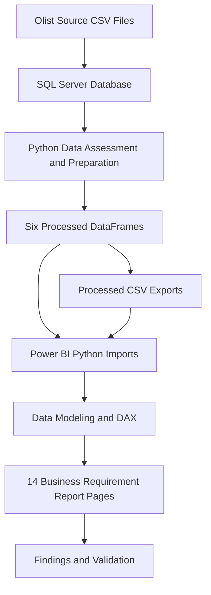
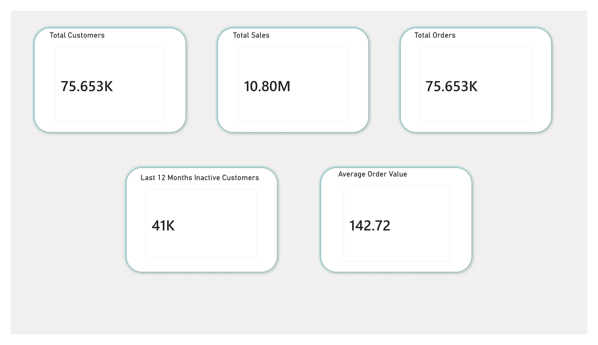
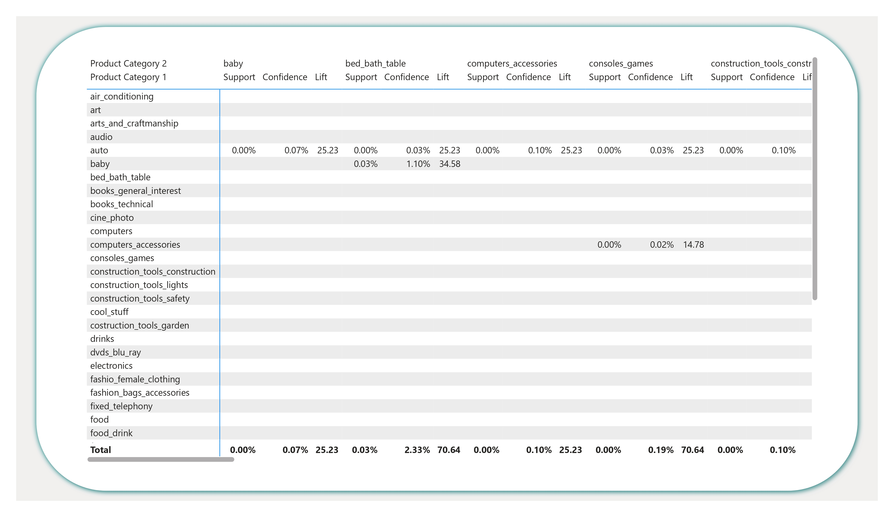

# Sales Analytics Project

An end-to-end e-commerce analytics project using the Olist Brazilian E-Commerce dataset, Microsoft SQL Server, Python, and Power BI.

The project follows an adapted CRISP-DM workflow, covering business understanding, data assessment, preparation, analytical modeling, visualization, and documentation.

## 1. Business Context and Objectives

The project addresses 14 analytical requirements defined by a hypothetical e-commerce client to assess sales performance, customer behavior, product performance, payment preferences, order fulfillment, and seller performance.

The objective is to prepare transactional data and develop a Power BI report that supports business performance monitoring and exploratory decision-making.

- [Project Brief](docs/project_brief.md)
- [Business Requirements](docs/business_requirements.md)

## 2. Technology Stack

| Technology | Application |
|---|---|
| Microsoft SQL Server | Source-data storage and retrieval |
| SQL Server Management Studio | Database creation and flat-file imports |
| SQL | Database setup, metadata inspection, and source-data extraction |
| Python | Data assessment, cleaning, and transformation |
| Pandas | Filtering, aggregation, joins, and DataFrame manipulation |
| PyODBC | SQL Server connectivity |
| Unidecode and Regular Expressions | Geographic text normalization |
| Jupyter Notebook | Interactive data assessment and transformation development |
| Power BI | Data modeling, analysis, and interactive reporting |
| DAX | Calculated columns, KPI measures, and analytical calculations |
| Power Query | Analytical table preparation |
| Git and GitHub | Version control and project documentation |

## 3. Dataset

**Source:** Olist Brazilian E-Commerce Public Dataset

The dataset contains anonymized e-commerce records associated with the Brazilian marketplace Olist.

| Attribute | Description |
|---|---|
| Raw datasets | 9 |
| Processed datasets | 6 |
| Raw order records | 99,441 |
| Raw order purchase period | September 2016 – October 2018 |
| Processed order purchase period | October 2016 – August 2018 |
| Processed transaction records | 80,156 |
| Power BI report pages | 14 |

The processed orders table contains aggregated transaction records rather than one record per unique order.

The original and processed schemas, field definitions, and logical relationships are documented in the [Data Dictionary](docs/data_dictionary.md).

## 4. Project Workflow



### 4.1. Database Setup

The nine source datasets were imported into a local SQL Server database using SQL Server Management Studio.

The SQL script creates the database and provides queries for inspecting its table and column metadata.

Python retrieves the source tables through PyODBC using Windows authentication.

### 4.2. Data Assessment and Preparation

Data preparation was performed in Python using Pandas.

The implemented transformations include:

- Inspecting dataset schemas, data types, missing values, and identifier uniqueness.
- Checking and removing duplicate geographic records.
- Normalizing customer, seller, and geolocation city names.
- Mapping Portuguese product categories to English.
- Filtering order records using timestamp eligibility conditions.
- Aggregating payments by order and payment method.
- Integrating orders, payments, order items, and customer information.
- Aggregating item prices and freight charges while retaining product quantities.
- Filtering customer reviews to match retained orders.
- Exporting six processed datasets as CSV files.

The transformation development process and execution outputs are available in `notebooks/01_data_cleaning.ipynb`.

The section-based transformation script is available in `src/data_cleaning.py`.

### 4.3. Processed Data Model

| Table | Rows | Purpose |
|---|---:|---|
| `customers` | 99,441 | Customer records and registered locations |
| `geo` | 19,612 | Postal code, city, and state information |
| `orders` | 80,156 | Consolidated transaction and fulfillment information |
| `products` | 32,951 | Product categories and photo counts |
| `reviews` | 75,503 | Order-linked customer feedback |
| `sellers` | 3,095 | Seller records and registered locations |

The Power BI model also contains `category_pairs` for market basket analysis and `measure_table` for analytical measures.

### 4.4. Business Analysis and Reporting

Business calculations and visualizations were developed primarily in Power BI using DAX and built-in visual aggregations.

The report contains 14 pages corresponding to the client requirements.

| Business Domain | Analytical Coverage |
|---|---|
| Executive sales overview | Customers, orders, sales, average order value, and inactivity |
| Customer behavior | Annual churn and customer inactivity |
| Product performance | Category contribution, product photos, recent products, seasonality, and price changes |
| Market basket analysis | Product category associations |
| Promotion analysis | Hypothetical BOGO profitability simulation |
| Payment analysis | Payment-method distribution |
| Fulfillment | Delivery timeliness, review scores, and fulfillment durations |
| Category maturity | First and last 90-day revenue comparison |
| Seller performance | Review scores and local-market sales |

The implemented report is available in `powerbi/sales_dashboard.pbix`.

Report-page completion does not establish that all analytical calculations have been validated.

### 4.5. Dashboard Screenshots





## 5. Key Findings

The data preparation process established that:

- Geographic records required substantial deduplication and text normalization.
- Payments and order items require different aggregation granularities.
- Repeated products within an order can represent valid purchased quantities rather than duplicate transactions.
- Customer identifiers have different meanings and must be selected according to the analytical requirement.
- Missing timestamps and restrictive filtering conditions affect analytical coverage.

Documented observations, analytical approaches, and outstanding validation requirements are available in [Findings](docs/findings.md).

Final dashboard result values have not been independently reconciled.

## 6. Analytical Limitations

- The consolidated orders table combines item-level and payment-method-level information. Multi-method payments may multiply transaction records and inflate aggregated values.
- The persistent customer identifier, `customer_unique_id`, was removed during preparation, limiting reliable customer retention and churn analysis.
- Timestamp filtering excludes records that fail eligibility conditions, including records with missing timestamps. This may introduce selection bias.
- Product launch dates are approximated using first observed purchases.
- Cost and profit information is unavailable. The promotion analysis uses an assumed profit margin and requires further validation.
- Market basket, payment, price, fulfillment, and seller calculations require aggregation-grain validation.
- The dataset represents historical marketplace activity and should not be interpreted as current business performance.

## 7. Repository Structure

```text
sales-analytics-project/
│
├── README.md
├── .gitignore
├── .gitattributes
├── requirements.txt
│
├── docs/
│   ├── business_requirements.md
│   ├── data_dictionary.md
│   ├── findings.md
│   └── project_brief.md
│
├── data/
│   ├── raw/
│   └── processed/
│
├── sql/
│   └── 01_create_db.sql
│
├── notebooks/
│   └── 01_data_cleaning.ipynb
│
├── src/
│   └── data_cleaning.py
│
├── powerbi/
│   └── sales_dashboard.pbix
│
└── reports/
    └── figures/
```

| Directory | Purpose |
|---|---|
| `docs/` | Business requirements, scope, data definitions, and findings |
| `data/raw/` | Original source datasets |
| `data/processed/` | Cleaned and transformed datasets |
| `sql/` | Database setup and schema inspection |
| `notebooks/` | Exploratory data inspection and transformation development |
| `src/` | Data transformation scripts |
| `powerbi/` | Power BI report and semantic model |
| `reports/figures/` | Reserved directory for exported figures |

## 8. Reproducing the Workflow

### Prerequisites

- Microsoft SQL Server and SQL Server Management Studio
- Microsoft ODBC Driver 17 for SQL Server
- Python and Jupyter Notebook
- Power BI Desktop
- Original Olist CSV datasets

### Execution

1. Execute `sql/01_create_db.sql` to create the database.
2. Import the nine source CSV datasets into SQL Server using SSMS.
3. Create and activate a Python virtual environment.
4. Install the required Python dependencies.

```bash
pip install -r requirements.txt
pip install pyodbc Unidecode
```

5. Update the SQL Server connection settings in the Python files.
6. Update the CSV export path in `notebooks/01_data_cleaning.ipynb`.
7. Execute the notebook to inspect, transform, and export the processed datasets.
8. Open `powerbi/sales_dashboard.pbix` in Power BI Desktop.
9. Update the report's data-source connections where required.

The transformation script contains separate import sections designed for use in Power BI. It is not a fully automated ETL pipeline.

The imported SQL schema must match the column names and data types expected by the Python transformations.

## 9. Skills Demonstrated

### Technical Skills

- SQL Server database setup and data retrieval
- Python-based data quality assessment
- Multi-table data integration
- Data filtering and aggregation
- Data grain identification
- Data modeling in Power BI
- DAX measure and calculated column development
- Business-oriented report design

### Analytical Skills

- Translating business questions into analytical requirements
- Defining KPIs and analytical calculations
- Identifying data quality and modeling limitations
- Time-window comparisons
- Category-level market basket analysis
- Scenario-based profitability analysis

### Professional Working Practices

- Structured repository organization
- Business and technical documentation
- Preservation of transformation logic
- Version control using Git
- Documentation of assumptions and validation requirements

## 10. Project Status

Data preparation and initial Power BI report development are complete.

Calculation validation, financial reconciliation, and final business interpretation remain outstanding.
