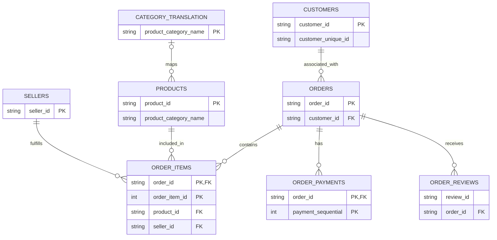
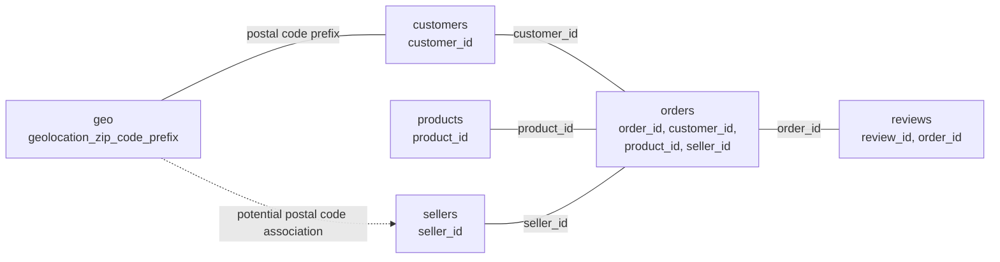

# Data Dictionary – Olist E-Commerce Dataset

## 1. Overview

This document defines the source datasets, processed schemas, field meanings, and logical relationships used in the Sales Analytics Project.

The project uses the Olist Brazilian E-Commerce Public Dataset, which contains transactional and operational information covering customers, orders, products, sellers, payments, fulfillment, geolocation, and reviews.

The original data consists of nine CSV datasets. Python transformations produce six processed datasets for analysis in Power BI.

The raw order purchase timestamps cover September 2016 to October 2018. The processed order purchase timestamps cover October 2016 to August 2018.

### 1.1. Source Dataset Inventory

| Dataset | Rows | Grain |
|---|---:|---|
| `olist_customers_dataset.csv` | 99,441 | Customer record |
| `olist_geolocation_dataset.csv` | 1,000,163 | Geographic observation |
| `olist_orders_dataset.csv` | 99,441 | Order |
| `olist_order_items_dataset.csv` | 112,650 | Individual order item |
| `olist_order_payments_dataset.csv` | 103,886 | Payment record |
| `olist_products_dataset.csv` | 32,951 | Product |
| `olist_sellers_dataset.csv` | 3,095 | Seller |
| `product_category_name_translation.csv` | 71 | Product category translation |
| `olist_order_reviews_dataset.csv` | 99,224 | Review record |

Row counts exclude CSV headers.

## 2. Source Dataset Schemas

The following key definitions describe source-data semantics and logical relationships. They do not imply that physical primary-key or foreign-key constraints have been implemented in SQL Server.

### 2.1. Customers

**File:** `olist_customers_dataset.csv`

Contains customer record identifiers, persistent customer identifiers, and registered locations.

| Column | Description |
|---|---|
| `customer_id` | Unique customer-record identifier referenced by orders. |
| `customer_unique_id` | Persistent anonymized customer identifier used to associate multiple customer records with the same customer. |
| `customer_zip_code_prefix` | Postal code prefix of the customer's registered address. |
| `customer_city` | Registered customer city. |
| `customer_state` | Registered customer state. |

**Logical key:** `customer_id`

The source notebook identifies 99,441 distinct customer record identifiers and 96,096 distinct persistent customer identifiers.

### 2.2. Geolocation

**File:** `olist_geolocation_dataset.csv`

Contains geographic observations associated with postal code prefixes.

| Column | Description |
|---|---|
| `geolocation_zip_code_prefix` | Postal code prefix of the geographic observation. |
| `geolocation_lat` | Latitude coordinate. |
| `geolocation_lng` | Longitude coordinate. |
| `geolocation_city` | Associated city name. |
| `geolocation_state` | Associated state. |

**Key considerations:**

- No unique primary key is established.
- Postal code prefixes may occur in multiple records.
- Geographic information can be associated with customer and seller records through postal code prefixes.

### 2.3. Orders

**File:** `olist_orders_dataset.csv`

Contains order-level status and fulfillment information.

| Column | Description |
|---|---|
| `order_id` | Unique order identifier. |
| `customer_id` | Customer record associated with the order. |
| `order_status` | Recorded order status. |
| `order_purchase_timestamp` | Date and time of order placement. |
| `order_approved_at` | Date and time of order approval. |
| `order_delivered_carrier_date` | Date and time of carrier handover. |
| `order_delivered_customer_date` | Date and time of customer delivery. |
| `order_estimated_delivery_date` | Estimated customer delivery date. |

**Logical key:** `order_id`

**Foreign-key reference:** `customer_id` references customers.

### 2.4. Order Items

**File:** `olist_order_items_dataset.csv`

Contains individual purchased items and their associated products, sellers, and monetary values.

| Column | Description |
|---|---|
| `order_id` | Associated order identifier. |
| `order_item_id` | Sequential item identifier within an order. |
| `product_id` | Purchased product identifier. |
| `seller_id` | Seller responsible for the order item. |
| `shipping_limit_date` | Deadline for the seller to hand over the item for shipment. |
| `price` | Selling price of the individual item, excluding freight. |
| `freight_value` | Freight charge associated with the individual item. |

**Logical composite key:** (`order_id`, `order_item_id`)

**Foreign-key references:**

- `order_id` references orders.
- `product_id` references products.
- `seller_id` references sellers.

Repeated products within the same order can represent distinct purchased units.

### 2.5. Order Payments

**File:** `olist_order_payments_dataset.csv`

Contains payment records and payment-method information associated with orders.

| Column | Description |
|---|---|
| `order_id` | Associated order identifier. |
| `payment_sequential` | Sequence number of a payment record within an order. |
| `payment_type` | Recorded payment method. |
| `payment_installments` | Number of installments associated with the payment. |
| `payment_value` | Monetary amount recorded for the payment. |

**Logical composite key:** (`order_id`, `payment_sequential`)

**Foreign-key reference:** `order_id` references orders.

An order may contain multiple payment records and payment methods.

Payment sequence and installment count describe different characteristics and should not be assumed equal.

### 2.6. Products

**File:** `olist_products_dataset.csv`

Contains product identifiers, listing attributes, category information, and physical dimensions.

| Column | Description |
|---|---|
| `product_id` | Unique product identifier. |
| `product_category_name` | Product category recorded in Portuguese. |
| `product_name_lenght` | Number of characters in the product name. |
| `product_description_lenght` | Number of characters in the product description. |
| `product_photos_qty` | Number of photographs associated with the product listing. |
| `product_weight_g` | Product weight in grams. |
| `product_length_cm` | Product length in centimeters. |
| `product_height_cm` | Product height in centimeters. |
| `product_width_cm` | Product width in centimeters. |

**Logical key:** `product_id`

The original spelling of `product_name_lenght` and `product_description_lenght` is preserved.

### 2.7. Sellers

**File:** `olist_sellers_dataset.csv`

Contains seller identifiers and registered geographic attributes.

| Column | Description |
|---|---|
| `seller_id` | Unique seller identifier. |
| `seller_zip_code_prefix` | Postal code prefix of the seller's registered location. |
| `seller_city` | Registered seller city. |
| `seller_state` | Registered seller state. |

**Logical key:** `seller_id`

### 2.8. Product Category Translation

**File:** `product_category_name_translation.csv`

Contains mappings between Portuguese and English product category names.

| Column | Description |
|---|---|
| `product_category_name` | Original Portuguese category name. |
| `product_category_name_english` | Corresponding English category name. |

**Logical key:** `product_category_name`

The Python transformations reference the imported SQL columns `product_category` and `product_category_english`.

The transformation also removes the first imported row, treating it as a duplicate header. This behavior is specific to the imported SQL representation and should be verified when recreating the database.

### 2.9. Order Reviews

**File:** `olist_order_reviews_dataset.csv`

Contains customer feedback associated with orders.

| Column | Description |
|---|---|
| `review_id` | Identifier associated with a review. |
| `order_id` | Order associated with the review. |
| `review_score` | Numerical customer rating from 1 to 5. |
| `review_comment_title` | Optional review title. |
| `review_comment_message` | Optional textual customer feedback. |
| `review_creation_date` | Date and time associated with review creation. |
| `review_answer_timestamp` | Recorded date and time of the review response. |

**Foreign-key reference:** `order_id` references orders.

Neither `review_id` nor `order_id` should be assumed to uniquely identify every review record.

## 3. Source Data Relationships

### 3.1. Logical Key Relationships

| Referenced Dataset | Referenced Column | Related Dataset | Related Column |
|---|---|---|---|
| Customers | `customer_id` | Orders | `customer_id` |
| Orders | `order_id` | Order Items | `order_id` |
| Orders | `order_id` | Order Payments | `order_id` |
| Orders | `order_id` | Order Reviews | `order_id` |
| Products | `product_id` | Order Items | `product_id` |
| Sellers | `seller_id` | Order Items | `seller_id` |
| Category Translation | `product_category_name` | Products | `product_category_name` |
| Geolocation | `geolocation_zip_code_prefix` | Customers | `customer_zip_code_prefix` |
| Geolocation | `geolocation_zip_code_prefix` | Sellers | `seller_zip_code_prefix` |

Geographic associations require postal code normalization and uniqueness checks.

### 3.2. Source Relationship Diagram

The diagram represents logical source relationships rather than implemented database constraints. Geographic associations are omitted from the diagram because postal code prefixes are not unique.

## 4. Cleaned and Merged Data Model

The Python transformations produce six processed DataFrames and corresponding CSV files.

### 4.1. Processed Table Inventory

| Table | Rows | Columns | Grain |
|---|---:|---:|---|
| `customers` | 99,441 | 4 | Customer record |
| `geo` | 19,612 | 3 | Distinct postal code, city, and state combination |
| `orders` | 80,156 | 19 | Aggregated transaction group |
| `products` | 32,951 | 3 | Product |
| `reviews` | 75,503 | 6 | Retained review record |
| `sellers` | 3,095 | 4 | Seller |

The processed schemas below use Pandas data types and non-null counts recorded in the final notebook outputs. They are not SQL Server or Power BI data-type definitions.

### 4.2. Customers

**File:** `data/processed/customers.csv`

| Column | Pandas Type | Non-Null Rows | Description |
|---|---|---:|---|
| `customer_id` | `str` | 99,441 | Customer-record identifier. |
| `customer_zip_code_prefix` | `int64` | 99,441 | Registered postal code prefix. |
| `customer_city` | `str` | 99,441 | Normalized customer city. |
| `customer_state` | `str` | 99,441 | Registered customer state. |

**Transformations:**

- Removed `customer_unique_id`.
- Standardized city-name capitalization.
- Applied accent normalization and regular expressions.

**Limitation:** Removing the persistent customer identifier prevents reliable identification of repeat customers across customer records.

### 4.3. Geolocation

**File:** `data/processed/geo.csv`

| Column | Pandas Type | Non-Null Rows | Description |
|---|---|---:|---|
| `geolocation_zip_code_prefix` | `str` | 19,612 | Geographic postal code prefix. |
| `geolocation_city` | `str` | 19,612 | Normalized city name. |
| `geolocation_state` | `str` | 19,612 | Associated state. |

**Transformations:**

- Standardized city-name capitalization.
- Removed duplicate records.
- Removed latitude and longitude.
- Applied accent normalization and character filtering.
- Standardized an identified city-name variation.
- Removed duplicate geographic combinations.

Postal code prefixes are not unique identifiers for this table.

### 4.4. Orders

**File:** `data/processed/orders.csv`

Contains consolidated order, payment, product, seller, shipping, and customer attributes.

| Column | Pandas Type | Non-Null Rows | Description |
|---|---|---:|---|
| `order_id` | `str` | 80,156 | Associated order identifier. |
| `customer_id` | `str` | 80,156 | Associated customer-record identifier. |
| `order_status` | `str` | 80,156 | Retained order status. |
| `order_purchase_timestamp` | `datetime64[us]` | 80,156 | Order placement timestamp. |
| `order_approved_at` | `datetime64[us]` | 80,156 | Order approval timestamp. |
| `order_delivered_carrier_date` | `datetime64[us]` | 80,156 | Carrier handover timestamp. |
| `order_delivered_customer_date` | `datetime64[us]` | 80,156 | Customer delivery timestamp. |
| `order_estimated_delivery_date` | `datetime64[us]` | 80,156 | Estimated delivery timestamp. |
| `payment_type` | `str` | 80,156 | Associated payment method. |
| `payment_value` | `float64` | 80,156 | Aggregated payment value for the order and payment method. |
| `product_id` | `str` | 80,156 | Associated product identifier. |
| `seller_id` | `str` | 80,156 | Associated seller identifier. |
| `shipping_limit_date` | `datetime64[us]` | 80,156 | Seller shipping deadline. |
| `price` | `float64` | 80,156 | Sum of item prices within the transaction group. |
| `freight_value` | `float64` | 80,156 | Sum of freight charges within the transaction group. |
| `quantity` | `int64` | 80,156 | Count of underlying non-null product records in the transaction group. |
| `customer_zip_code_prefix` | `int64` | 80,156 | Customer postal code prefix. |
| `customer_city` | `str` | 80,156 | Normalized customer city. |
| `customer_state` | `str` | 80,156 | Customer state. |

#### Transformation Logic

1. Filter orders using non-negative approval and carrier-handover time differences.
2. Remove canceled orders containing customer-delivery timestamps.
3. Remove payment sequence and installment fields.
4. Aggregate payments by `order_id` and `payment_type`.
5. Inner join orders with aggregated payments.
6. Inner join the result with order items.
7. Retain records satisfying the shipping deadline conditions.
8. Remove `order_item_id`.
9. Aggregate price, freight, and item quantities.
10. Inner join the result with processed customer records.

The shipping deadline conditions require `shipping_limit_date` to be later than the purchase and approval timestamps and earlier than customer delivery.

Records with missing timestamps also fail relevant comparison conditions.

#### Aggregation Grain

The table is grouped by:

- `order_id`
- `customer_id`
- `order_status`
- `order_purchase_timestamp`
- `order_approved_at`
- `order_delivered_carrier_date`
- `order_delivered_customer_date`
- `order_estimated_delivery_date`
- `payment_type`
- `payment_value`
- `product_id`
- `seller_id`
- `shipping_limit_date`

Within each group, item prices and freight charges are summed, and quantity is calculated by counting non-null product identifier records.

`order_id` is not a unique key in the processed table.

#### Aggregation Considerations

| Field | Intended Interpretation |
|---|---|
| `price` | Aggregated item selling price excluding freight. |
| `freight_value` | Aggregated item freight charges. |
| `quantity` | Count of underlying joined item records. |
| `payment_value` | Payment amount aggregated at the order-payment-method grain. |

The payment and item joins can multiply records when an order uses multiple payment methods.

Consequently:

- Price, freight, and quantity require reconciliation before aggregation.
- Payment values should not be summed across product groups without correcting repeated amounts.
- Orders should be counted using distinct `order_id` values.
- Aggregated price should not be multiplied by quantity.
- Average unit price requires reconciled price and quantity information.

### 4.5. Products

**File:** `data/processed/products.csv`

| Column | Pandas Type | Non-Null Rows | Description |
|---|---|---:|---|
| `product_id` | `str` | 32,951 | Product identifier. |
| `product_category_name` | `str` | 32,341 | Standardized English product category. |
| `product_photos_qty` | `str` | 32,341 | Number of product listing photographs. |

**Transformations:**

- Removed product-name length, description length, weight, and dimension fields.
- Left joined the product category translation table.
- Assigned `pc_gamer` to `computers`.
- Assigned `portateis_cozinha_e_preparadores_de_alimentos` to `small_appliances_home_oven_and_coffee`.
- Replaced Portuguese category names with English category names.
- Removed redundant translation fields.

Both category and photo-count fields contain 610 missing values.

The photo-count field is represented as a string in the notebook output and requires appropriate numeric interpretation for quantitative analysis.

### 4.6. Reviews

**File:** `data/processed/reviews.csv`

| Column | Pandas Type | Non-Null Rows | Description |
|---|---|---:|---|
| `review_id` | `str` | 75,503 | Review identifier. |
| `order_id` | `str` | 75,503 | Associated retained order identifier. |
| `review_score` | `int64` | 75,503 | Numerical customer rating. |
| `review_comment_message` | `str` | 30,960 | Optional textual feedback. |
| `review_creation_date` | `datetime64[us]` | 75,503 | Review creation timestamp. |
| `review_answer_timestamp` | `object` | 75,503 | Review answer date after date conversion. |

**Transformations:**

- Removed review-comment titles.
- Converted review answer timestamps to dates.
- Retained reviews associated with processed orders.

The review-comment field contains 44,543 missing values.

Neither review identifiers nor order identifiers should be assumed unique in this table.

### 4.7. Sellers

**File:** `data/processed/sellers.csv`

| Column | Pandas Type | Non-Null Rows | Description |
|---|---|---:|---|
| `seller_id` | `str` | 3,095 | Seller identifier. |
| `seller_zip_code_prefix` | `int64` | 3,095 | Registered seller postal code prefix. |
| `seller_city` | `str` | 3,095 | Normalized seller city. |
| `seller_state` | `str` | 3,095 | Registered seller state. |

**Transformations:**

- Standardized seller-city capitalization.
- Checked for duplicate records and seller identifiers.
- Removed characters other than alphabetic characters and whitespace.

Unlike customer and geolocation city transformations, the seller transformation does not explicitly apply accent normalization before character filtering.

### 4.8. Processed Logical Relationships

| Table | Column | Related Table | Related Column |
|---|---|---|---|
| `customers` | `customer_id` | `orders` | `customer_id` |
| `products` | `product_id` | `orders` | `product_id` |
| `sellers` | `seller_id` | `orders` | `seller_id` |
| `orders` | `order_id` | `reviews` | `order_id` |
| `geo` | `geolocation_zip_code_prefix` | `customers` | `customer_zip_code_prefix` |
| `geo` | `geolocation_zip_code_prefix` | `sellers` | `seller_zip_code_prefix` |

These relationships describe available logical join paths. They do not establish actual Power BI relationship cardinalities or filter directions.

The project notes explicitly document connections between orders and reviews and between geolocation and customers.

A direct geolocation-to-sellers relationship is a possible logical association, not a verified implemented model connection.

### 4.9. Processed Relationship Diagram

The diagram omits cardinality symbols for relationships where uniqueness or filter behavior requires further validation.

## 5. Power BI Analytical Model

The Power BI model diagram contains the six processed data tables and two analytical support tables.

### 5.1. Category Pairs

**Table:** `category_pairs`

Constructed by combining orders with product categories and performing a self-merge to identify categories associated with the same order.

| Column | Description |
|---|---|
| `order_id` | Associated order identifier. |
| `category_1` | First category in the pair. |
| `category_2` | Second category in the pair. |

The recorded transformation retains category pairs satisfying `category_1 < category_2`, removing self-pairs and reverse-order combinations.

Uniqueness of order-category pairs requires validation before calculating transaction-based association metrics.

### 5.2. Measure Table

**Table:** `measure_table`

Support table used to organize DAX measures for business requirements.

The report contains measure references for sales KPIs, inactivity, churn, category contribution, market basket metrics, recent product performance, annual changes, profitability simulation, fulfillment durations, category revenue comparisons, and local sales share.

### 5.3. Analytical Fields

The following additional fields and classifications are described in the project development notes and report metadata.

| Table | Field or Classification | Description |
|---|---|---|
| `orders` | `delivery_status` | Classifies transactions as late or on time using actual and estimated delivery timestamps. |
| `orders` | `is_local_sale` | Indicates whether the seller and customer states match. |
| `products` | Recent-product classification | Identifies recently observed products using first observed purchase as a launch-date proxy. |

These are Power BI analytical additions and are not columns in the six exported CSV files.

## 6. Data Quality and Modeling Considerations

- Customer-record identifiers do not represent persistent unique customers.
- Payment and order-item joins introduce a risk of transaction multiplication.
- Timestamp filters exclude records with missing required values and may remove valid early deliveries.
- Geographic postal code prefixes are not unique.
- Postal code data types differ between processed tables. Leading zeros and data types require normalization before joining.
- Review identifiers and order identifiers may be repeated.
- Product category and photo-count fields contain missing values.
- Customer location attributes are repeated in the consolidated orders table.
- The dataset does not contain explicit product launch dates, product costs, or profit margins.
- Physical database constraints, Power BI relationship cardinalities, filter directions, and final measure correctness require separate validation.

## 7. References

- Olist Brazilian E-Commerce Public Dataset
- Client-provided Olist data dictionary
- `notebooks/01_data_cleaning.ipynb`
- `src/data_cleaning.py`
- `data/raw/`
- `data/processed/`
- `powerbi/sales_dashboard.pbix`
- Project development notes
