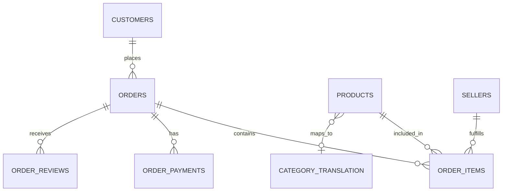

# Data Dictionary – Olist E-Commerce Dataset

## 1. Overview

This document defines the structure, attributes, and relationships of the datasets used in the Sales Analytics Project.

The project uses the Olist Brazilian E-Commerce dataset, which contains transactional and operational data covering customers, orders, products, sellers, payments, delivery information, geolocation, and customer reviews.

The data dictionary serves as a reference for understanding the underlying data model and maintaining consistency throughout the data cleaning, exploratory analysis, SQL analysis, and business intelligence development phases.

### Dataset Inventory

| No. | Dataset | Description |
|---|---|---|
| 1 | `olist_customers_dataset.csv` | Customer master data and geographic information |
| 2 | `olist_geolocation_dataset.csv` | Geographic coordinates associated with postal code prefixes |
| 3 | `olist_orders_dataset.csv` | Order-level transactional and fulfillment information |
| 4 | `olist_order_items_dataset.csv` | Individual products and seller information associated with orders |
| 5 | `olist_order_payments_dataset.csv` | Payment transactions and payment methods associated with orders |
| 6 | `olist_products_dataset.csv` | Product master data and physical attributes |
| 7 | `olist_sellers_dataset.csv` | Seller master data and geographic information |
| 8 | `product_category_name_translation.csv` | Mapping of Portuguese product categories to English |
| 9 | `olist_order_reviews_dataset.csv` | Customer feedback and order review information |

---

## 2. Dataset Schemas and Column Definitions

### 2.1 Customer Dataset

**File:** `olist_customers_dataset.csv`

**Description:** Contains customer-level information, including anonymized customer identifiers and geographic attributes. This dataset supports customer profiling, geographic segmentation, and customer-level sales analysis.

| Column Name | Description |
|---|---|
| `customer_id` | Unique identifier assigned to a customer record. |
| `customer_unique_id` | Anonymized identifier representing a unique customer across customer records. |
| `customer_zip_code_prefix` | Postal code prefix associated with the customer's registered address. |
| `customer_city` | City in which the customer is located. |
| `customer_state` | State in which the customer is located. |

**Key Constraints:**
- Primary Key: `customer_id`
- `customer_unique_id` can be used to identify customers across multiple customer records.
- `customer_id` is referenced by `olist_orders_dataset.csv`.

---

### 2.2 Geolocation Dataset

**File:** `olist_geolocation_dataset.csv`

**Description:** Contains geographic information mapped to postal code prefixes, including latitude, longitude, city, and state. This dataset supports geographic analysis and location-based business insights.

| Column Name | Description |
|---|---|
| `geolocation_zip_code_prefix` | Postal code prefix associated with a geographic location. |
| `geolocation_lat` | Latitude coordinate representing the geographic location. |
| `geolocation_lng` | Longitude coordinate representing the geographic location. |
| `geolocation_city` | City associated with the geographic location. |
| `geolocation_state` | State associated with the geographic location. |

**Key Considerations:**
- The dataset does not specify a unique primary key.
- Multiple records may exist for the same postal code prefix.
- Postal code prefixes can be used to associate geographic information with customer and seller records.

---

### 2.3 Orders Dataset

**File:** `olist_orders_dataset.csv`

**Description:** Contains order-level transactional information, including order status and timestamps associated with the order lifecycle. This dataset serves as the central transactional entity for analyzing sales performance, order fulfillment, and delivery efficiency.

| Column Name | Description |
|---|---|
| `order_id` | Unique identifier assigned to each customer order. |
| `customer_id` | Identifier of the customer who placed the order. |
| `order_status` | Current recorded status of the order, such as delivered, shipped, or canceled. |
| `order_purchase_timestamp` | Timestamp indicating when the customer placed the order. |
| `order_approved_at` | Timestamp indicating when the order payment was approved. |
| `order_delivered_carrier_date` | Timestamp indicating when the order was handed over to the logistics carrier. |
| `order_delivered_customer_date` | Timestamp indicating when the order was successfully delivered to the customer. |
| `order_estimated_delivery_date` | Estimated delivery date communicated for the order. |

**Key Constraints:**
- Primary Key: `order_id`
- Foreign Key: `customer_id` references `olist_customers_dataset.csv`.
- Order timestamps support calculations such as order processing time, shipping time, and delivery delays.

---

### 2.4 Order Items Dataset

**File:** `olist_order_items_dataset.csv`

**Description:** Contains line-item-level information for products included in customer orders. Each record represents an individual product item within an order, along with its associated seller, pricing, and shipping information.

This dataset enables product performance analysis, seller-level sales analysis, and order value calculations.

| Column Name | Description |
|---|---|
| `order_id` | Identifier of the order to which the item belongs. |
| `order_item_id` | Sequential item number identifying an individual item within an order. |
| `product_id` | Identifier of the product included in the order. |
| `seller_id` | Identifier of the seller responsible for fulfilling the item. |
| `shipping_limit_date` | Deadline by which the seller is expected to hand over the item for shipment. |
| `price` | Selling price of the individual product item. |
| `freight_value` | Shipping charge associated with the individual order item. |

**Key Constraints:**
- Composite Primary Key: (`order_id`, `order_item_id`).
- Foreign Key: `order_id` references `olist_orders_dataset.csv`.
- Foreign Key: `product_id` references `olist_products_dataset.csv`.
- Foreign Key: `seller_id` references `olist_sellers_dataset.csv`.

---

### 2.5 Order Payments Dataset

**File:** `olist_order_payments_dataset.csv`

**Description:** Contains payment-level information associated with customer orders, including payment methods, installment details, and transaction values.

This dataset supports payment behavior analysis, revenue reconciliation, and payment method segmentation.

| Column Name | Description |
|---|---|
| `order_id` | Identifier of the order associated with the payment. |
| `payment_sequential` | Sequential identifier representing the payment record within an order. |
| `payment_type` | Payment method used for the transaction, such as credit card, debit card, or voucher. |
| `payment_installments` | Number of installments selected for the payment. |
| `payment_value` | Monetary value recorded for the individual payment transaction. |

**Key Constraints:**
- Composite Primary Key: (`order_id`, `payment_sequential`).
- Foreign Key: `order_id` references `olist_orders_dataset.csv`.
- An order may contain multiple payment records.
- Total payment value at the order level can be calculated by aggregating `payment_value` across its payment records.

---

### 2.6 Products Dataset

**File:** `olist_products_dataset.csv`

**Description:** Contains product master data, including product category, descriptive attributes, image quantity, and physical dimensions. This dataset supports product segmentation, category-level performance analysis, and product attribute analysis.

| Column Name | Description |
|---|---|
| `product_id` | Unique identifier assigned to each product. |
| `product_category_name` | Product category to which the product belongs, originally recorded in Portuguese. |
| `product_name_lenght` | Number of characters in the product name. |
| `product_description_lenght` | Number of characters in the product description. |
| `product_photos_qty` | Number of photographs associated with the product listing. |
| `product_weight_g` | Product weight measured in grams. |
| `product_length_cm` | Product length measured in centimeters. |
| `product_height_cm` | Product height measured in centimeters. |
| `product_width_cm` | Product width measured in centimeters. |

**Key Constraints:**
- Primary Key: `product_id`.
- `product_id` is referenced by `olist_order_items_dataset.csv`.
- `product_category_name` can be mapped to its English equivalent using `product_category_name_translation.csv`.

**Data Quality Consideration:**
- The original column names `product_name_lenght` and `product_description_lenght` retain their source spelling. Any renaming should be handled explicitly during data transformation.

---

### 2.7 Sellers Dataset

**File:** `olist_sellers_dataset.csv`

**Description:** Contains seller master data, including unique seller identifiers and geographic attributes. This dataset supports seller performance evaluation and geographic analysis of the seller network.

| Column Name | Description |
|---|---|
| `seller_id` | Unique identifier assigned to each seller. |
| `seller_zip_code_prefix` | Postal code prefix associated with the seller's registered location. |
| `seller_city` | City in which the seller is located. |
| `seller_state` | State in which the seller is located. |

**Key Constraints:**
- Primary Key: `seller_id`.
- `seller_id` is referenced by `olist_order_items_dataset.csv`.

---

### 2.8 Product Category Translation Dataset

**File:** `product_category_name_translation.csv`

**Description:** Provides a translation mapping between product category names originally recorded in Portuguese and their corresponding English names. This dataset supports standardized category reporting and improves the accessibility of product-level analysis.

| Column Name | Description |
|---|---|
| `product_category_name` | Original product category name in Portuguese. |
| `product_category_name_english` | Corresponding English translation of the product category name. |

**Key Considerations:**
- `product_category_name` serves as the category mapping key.
- The translated category name can be used in reports and visualizations.
- The source document does not establish a formal primary key constraint.

---

### 2.9 Order Reviews Dataset

**File:** `olist_order_reviews_dataset.csv`

**Description:** Contains customer feedback associated with orders, including numerical review scores, optional textual comments, and review-related timestamps.

This dataset supports customer satisfaction analysis, review score distribution analysis, and the identification of potential relationships between delivery performance and customer feedback.

| Column Name | Description |
|---|---|
| `review_id` | Unique identifier assigned to a customer review. |
| `order_id` | Identifier of the order associated with the review. |
| `review_score` | Numerical customer rating ranging from 1 to 5. |
| `review_comment_title` | Optional title provided by the customer as part of the review. |
| `review_comment_message` | Optional textual feedback submitted by the customer. |
| `review_creation_date` | Timestamp indicating when the review was created. |
| `review_answer_timestamp` | Timestamp indicating when a response to the review was recorded, where applicable. |

**Key Constraints and Considerations:**
- `review_id` is the review identifier.
- Foreign Key: `order_id` references `olist_orders_dataset.csv`.
- Review comment fields are optional and may contain NULL values.
- The dataset may contain multiple reviews associated with an order; uniqueness of `order_id` should not be assumed.

---

## 3. Entity Relationships and Data Model

The datasets are interconnected through shared identifiers, allowing transactional, customer, product, seller, and payment information to be combined for analytical purposes.

### 3.1 Primary and Foreign Key Relationships

| Parent Dataset | Parent Key | Child Dataset | Foreign Key |
|---|---|---|---|
| Customers | `customer_id` | Orders | `customer_id` |
| Orders | `order_id` | Order Items | `order_id` |
| Orders | `order_id` | Order Payments | `order_id` |
| Orders | `order_id` | Order Reviews | `order_id` |
| Products | `product_id` | Order Items | `product_id` |
| Sellers | `seller_id` | Order Items | `seller_id` |
| Products | `product_category_name` | Category Translation | `product_category_name` |

### 3.2 High-Level Relationship Diagram

---

**Source:** Olist Brazilian E-Commerce Public Dataset.