# Findings – Sales Analytics Project

## 1. Overview

This document summarizes the data preparation findings, business analyses implemented in Power BI, and key analytical limitations of the sales analytics project.

The Power BI report contains 14 pages corresponding to the [Business Requirements](business_requirements.md). The data preparation findings are based on recorded notebook outputs and development notes. The dashboard screenshots illustrate the implemented analyses; numerical business results are stated in the text only where documented. Unless otherwise indicated, the analyses are exploratory and relate to the retained transactions rather than the entire source dataset.

## 2. Data Quality and Preparation Findings

### 2.1. Customer Identifiers

| Metric | Value |
|---|---:|
| Customer records | 99,441 |
| Distinct `customer_id` values | 99,441 |
| Distinct `customer_unique_id` values | 96,096 |
| Difference between identifier counts | 3,345 |

`customer_id` identifies individual customer records, whereas `customer_unique_id` identifies customers across records. The processed model retains only `customer_id`; consequently, customer-record counts should not be interpreted as unique-person counts.

**Evidence:** `01_data_cleaning.ipynb`

### 2.2. Geographic Data

| Metric | Value |
|---|---:|
| Original geolocation records | 1,000,163 |
| Duplicate records after initial city capitalization | 261,831 |
| Records after initial deduplication | 738,332 |
| Final processed geographic records | 19,612 |

City names were standardized through capitalization, accent normalization, and text cleaning. Geographic coordinates were removed and duplicate records eliminated. Accent normalization reduced the number of distinct city-name strings from 8,011 to 5,969, improving consistency in geographic reporting.

**Evidence:** `01_data_cleaning.ipynb`

### 2.3. Product Category Standardization

The source products table contained 73 distinct non-null Portuguese category names, compared with 71 categories in the imported translation table. Two unmatched categories were mapped manually:

| Original category | Assigned category |
|---|---|
| `pc_gamer` | `computers` |
| `portateis_cozinha_e_preparadores_de_alimentos` | `small_appliances_home_oven_and_coffee` |

The final products table contains 32,951 records. Both `product_category_name` and `product_photos_qty` contain 610 missing values, which limit complete category-level and photo-count analyses.

**Evidence:** `01_data_cleaning.ipynb`

### 2.4. Order Eligibility and Filtering

| Processing stage | Count | Unit |
|---|---:|---|
| Original orders | 99,441 | Order records |
| After initial timestamp filtering | 96,285 | Order records |
| After removing canceled orders with delivery timestamps | 96,279 | Order records |
| After payment join | 96,278 | Distinct orders |
| After item join | 96,277 | Distinct orders |
| Before shipping deadline filtering | 112,310 | Transaction rows |
| After shipping deadline filtering | 88,002 | Transaction rows |
| Final aggregated transactions | 80,156 | Transaction rows |

Timestamp conditions, cancellation filters, inner joins, and transaction aggregation produced a filtered transaction dataset. Missing timestamps also caused records to fail the eligibility conditions. The final row count represents aggregated transactions, not distinct orders.

**Evidence:** `01_data_cleaning.ipynb`, `part-1.txt`

### 2.5. Payment Aggregation and Financial Consistency

| Metric | Value |
|---|---:|
| Original payment records | 103,886 |
| Aggregated payment records | 101,686 |
| Reduction in payment records | 2,200 |

Payments were aggregated by `order_id` and `payment_type` after removing payment sequence and installment fields, then joined with order items.

Two example orders were examined to compare item prices and freight charges with recorded payments:

| Order ID | Price + Freight | Payment value |
|---|---:|---:|
| `8272b63d03f5f79c56e9e4120aec44ef` | 196.17 | 196.11 |
| `ab14fdcfbe524636d65ee38360e22ce8` | 2,262.80 | 2,262.80 |

The examples show one small discrepancy and one matching total (rounded to two decimal places). They do not establish financial consistency across the entire dataset.

**Evidence:** `01_data_cleaning.ipynb`, `data_cleaning.py`, `part-1.txt`

### 2.6. Product Quantity Preservation

Repeated `product_id` values within an order were identified as valid purchased items when associated with different `order_item_id` values. The revised aggregation retains the number of underlying item records in a derived `quantity` field.

The processed `price` and `freight_value` fields represent aggregated monetary amounts rather than unit-level values. Quantity-based analysis therefore uses `SUM(quantity)` rather than aggregated row counts, subject to the transaction-grain limitation described in Section 4.

**Evidence:** `01_data_cleaning.ipynb`, `data_cleaning.py`, `part-2.txt`

### 2.7. Customer Reviews

| Metric | Value |
|---|---:|
| Original review records | 99,224 |
| Retained review records | 75,503 |
| Retained reviews with comments | 30,960 |
| Retained reviews without comments | 44,543 |

Review titles were removed, review answer timestamps were converted to dates, and reviews were restricted to retained orders. Numerical review scores support customer satisfaction analysis, while written feedback is available for only a subset of the retained reviews.

**Evidence:** `01_data_cleaning.ipynb`

## 3. Business Analysis and Dashboard Outputs

The following sections describe the analytical purpose and implementation of each report page. The screenshots provide the visual outputs of the implemented measures. Their interpretation is subject to the limitations in Section 4.

### BR-01 — Core Sales and Customer KPIs

The executive overview presents customers, orders, sales, average order value, and customer inactivity. Sales are defined as item prices excluding freight, and average order value uses distinct order identifiers as its denominator.

| Metric | Documented result |
|---|---:|
| Distinct customer records in the customer table | Approximately 99.44K |
| Distinct customer records in the orders table | Approximately 75.65K |

The difference reflects customer records not represented in the retained transactions; it should not be interpreted as churn or customer inactivity.

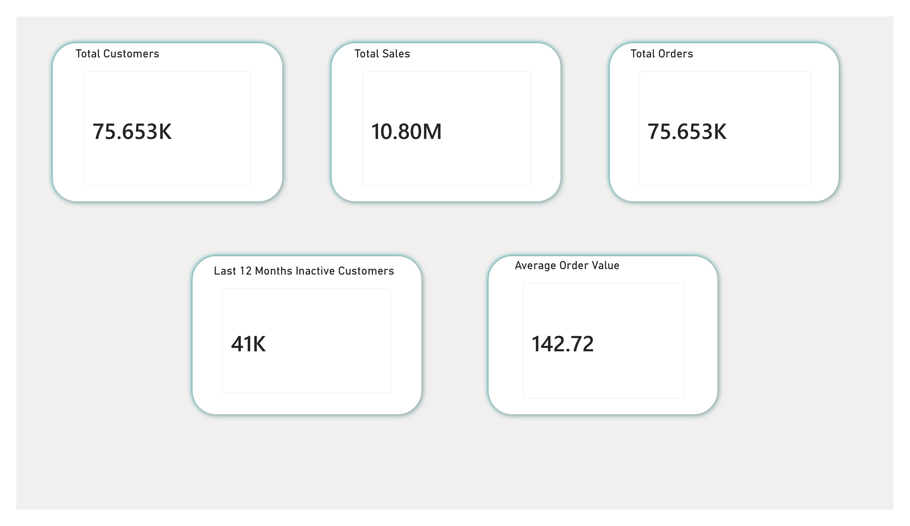

### BR-02 — Product Category Contribution

A DAX measure calculates each product category's sales contribution relative to the selected overall sales value, providing a view of category-level revenue concentration.

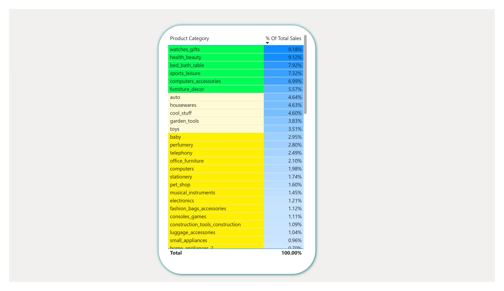

### BR-03 — Annual Customer Churn

The annual churn table uses each customer record's last observed purchase year, with the final observed year treated as indeterminate. This is an exploratory purchase-history measure rather than a reliable repeat-customer churn estimate.

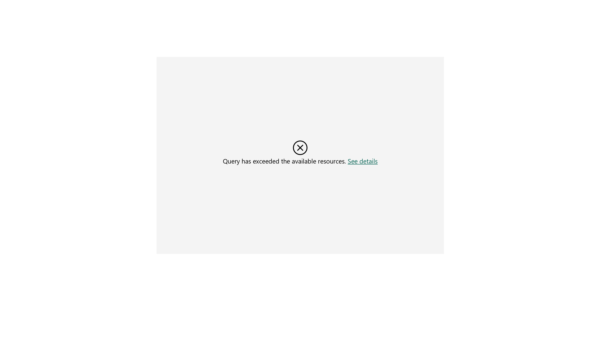

### BR-04 — Product Photos and Quantity Sold

A line chart compares product photo counts with aggregated quantities sold. The comparison explores an association between product imagery and sales volume; it does not establish a causal effect.

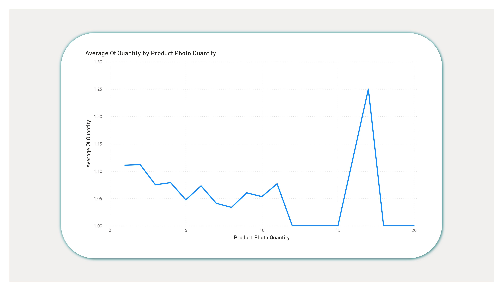

### BR-05 — Market Basket Analysis

A category-pair table identifies product categories purchased within the same order. The report presents a matrix of implemented support, confidence, and lift measures to explore cross-selling opportunities. The association-rule results remain exploratory because of the calculation issues described in Section 4.

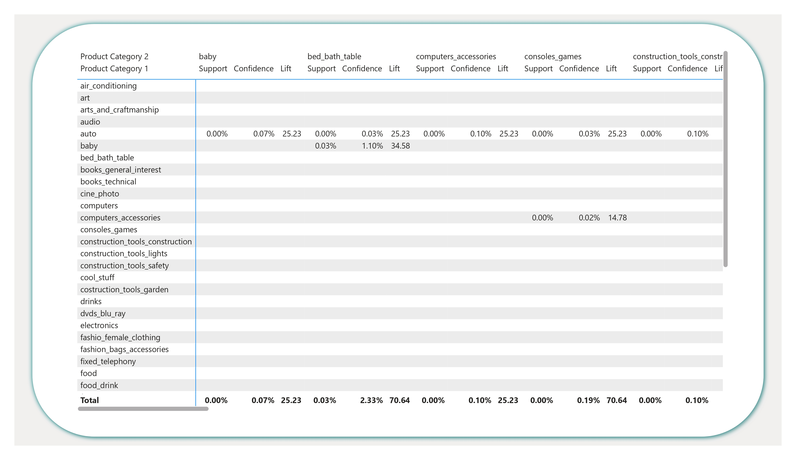

### BR-06 — Recently Launched Product Performance

Products are classified using their first observed purchase date relative to the latest date in the dataset. The report compares sales and orders across categories for recently observed products. First observed purchase is a proxy, not the actual product launch date.

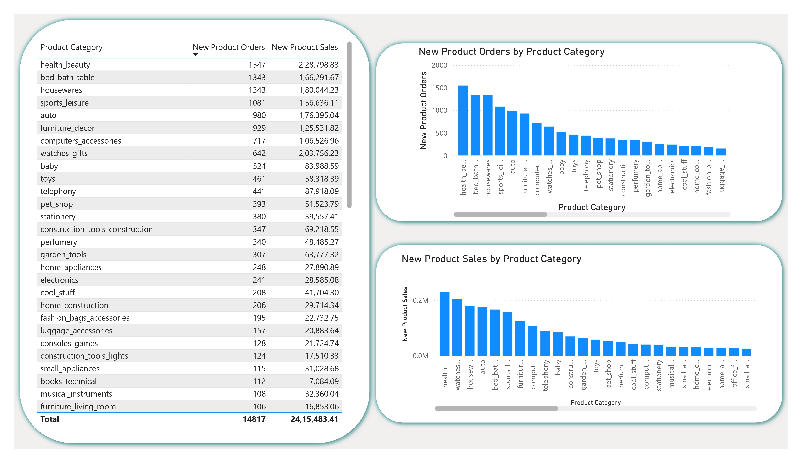

### BR-07 — Monthly Sales Seasonality

Monthly transaction-row counts are compared across product categories and years to explore demand patterns. These counts are not equivalent to units sold, and the available results do not establish recurring seasonality.

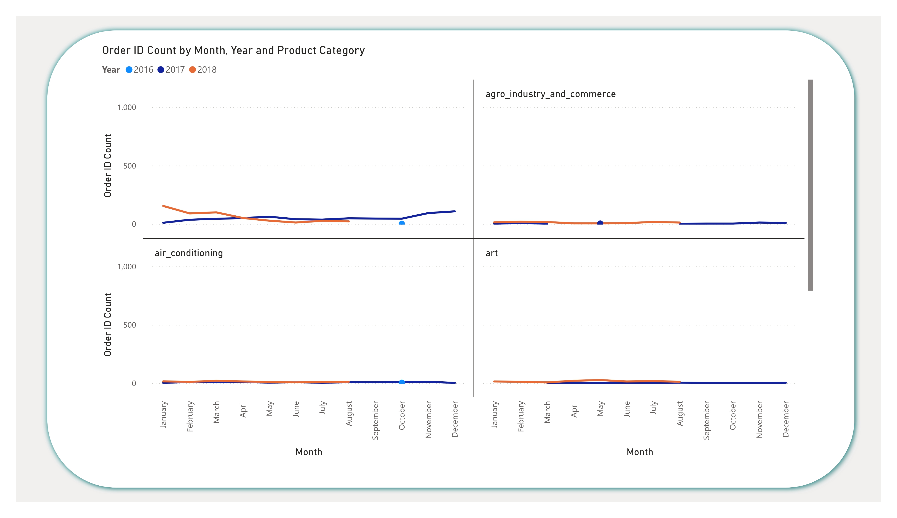

### BR-08 — Product Price Changes and Sales

DAX measures compare year-to-year changes in average aggregated price and average quantity per transaction row. The analysis explores changes in recorded prices and sales quantities; it does not measure causal price sensitivity or price elasticity.

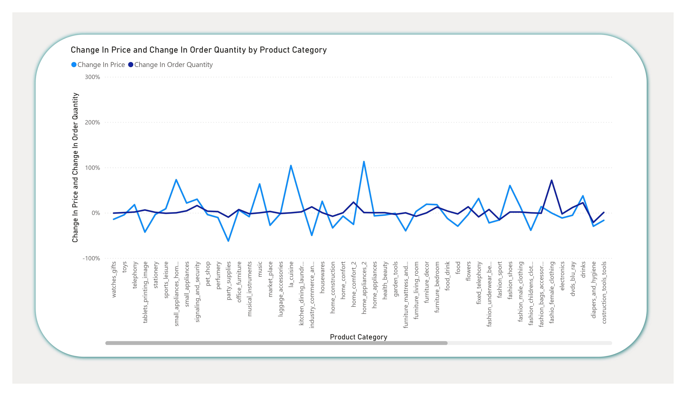

### BR-09 — BOGO Promotion Simulation

A hypothetical buy-one-get-one-free promotion is modeled for the top 10 products by quantity sold, using the following assumptions:

- Quantity sold doubles.
- Every second unit is provided free of charge.
- The original selling price consists of 60% cost and 40% profit.

The simulation illustrates a promotional scenario rather than observed business performance. Actual product costs and margins are unavailable, and the implemented calculation does not fully account for the cost of free units.

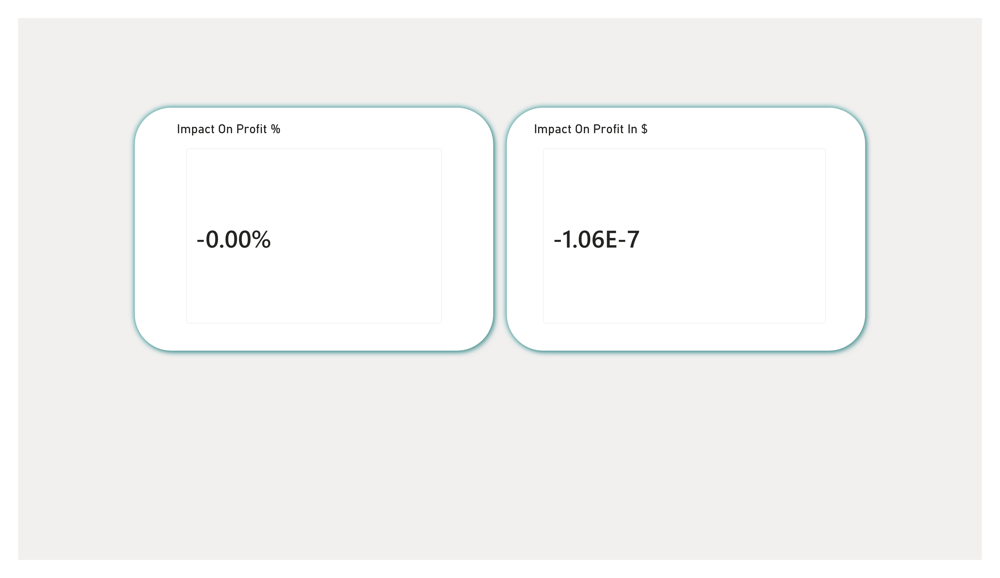

### BR-10 — Payment Method Distribution

A pie chart compares aggregated payment values across payment methods to describe the recorded payment mix.

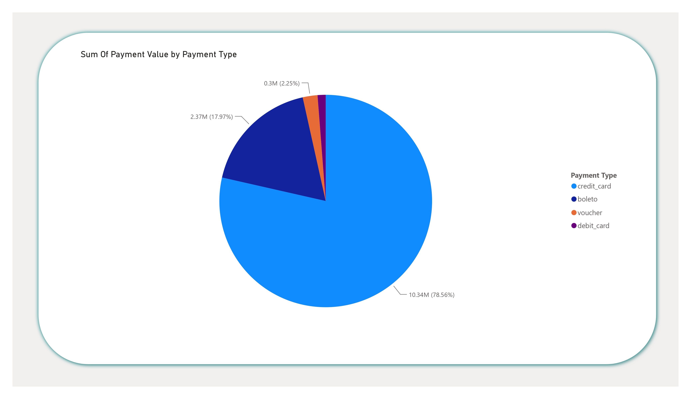

### BR-11 — Delivery Timeliness and Review Scores

Orders are classified as late when actual delivery occurs after estimated delivery. Average review scores are compared across delivery-status groups to explore the association between delivery performance and customer satisfaction.

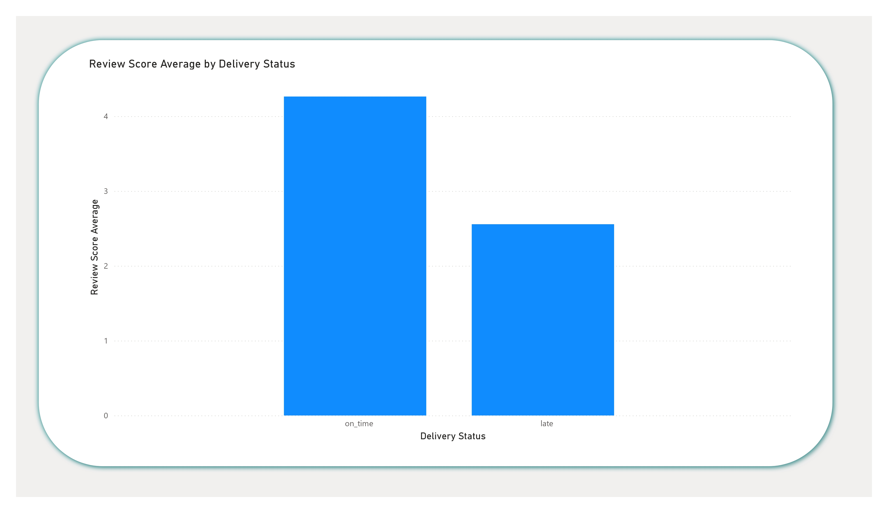

### BR-12 — Order Fulfillment Stage Durations

DAX measures calculate average elapsed hours across three fulfillment stages. The report provides a view of processing and delivery durations that can support the investigation of operational bottlenecks.

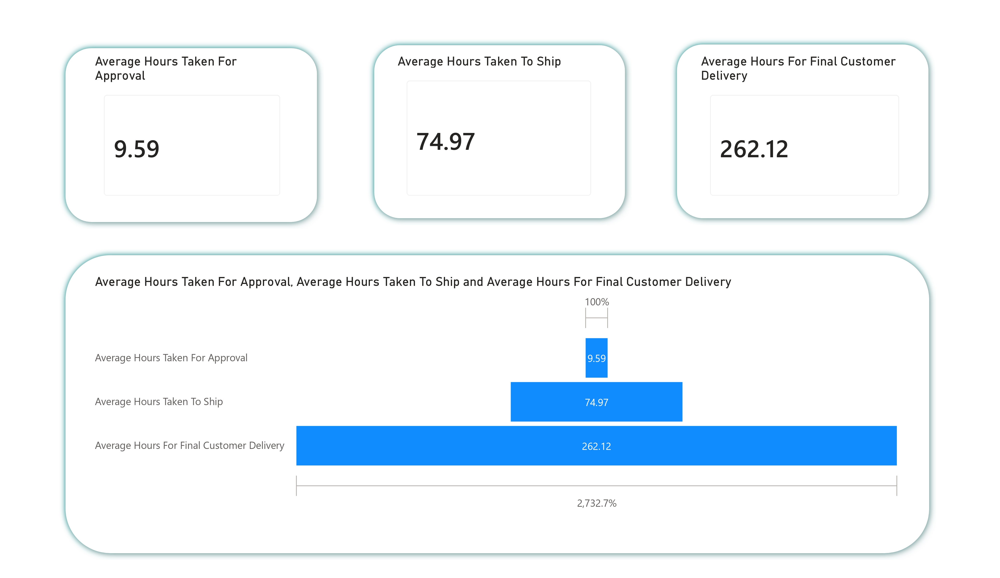

### BR-13 — Category Revenue Maturity

Category revenue is compared over category-specific first and last 90-day windows based on observed purchase timestamps. The report presents initial revenue, final revenue, and percentage revenue change to explore changes in category performance. These windows reflect observed purchase history rather than confirmed platform introduction dates.

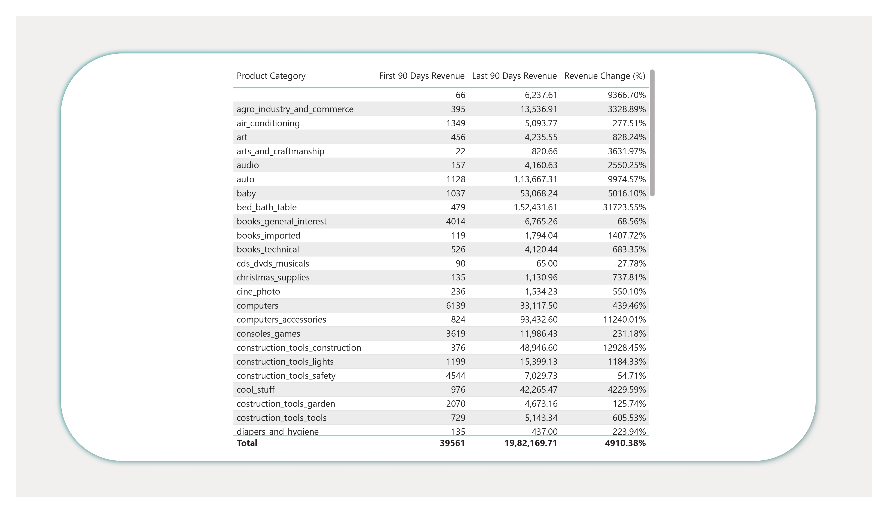

### BR-14 — Highly Rated Sellers with Low Local Sales Share

Local transactions are identified by matching customer and seller states. The business requirement targets sellers with average review scores above 4.5 and local sales contribution below 10%, with the objective of identifying potential opportunities for local market expansion. The implemented share calculation requires a consistent aggregation grain before sellers can be reliably classified against these thresholds.

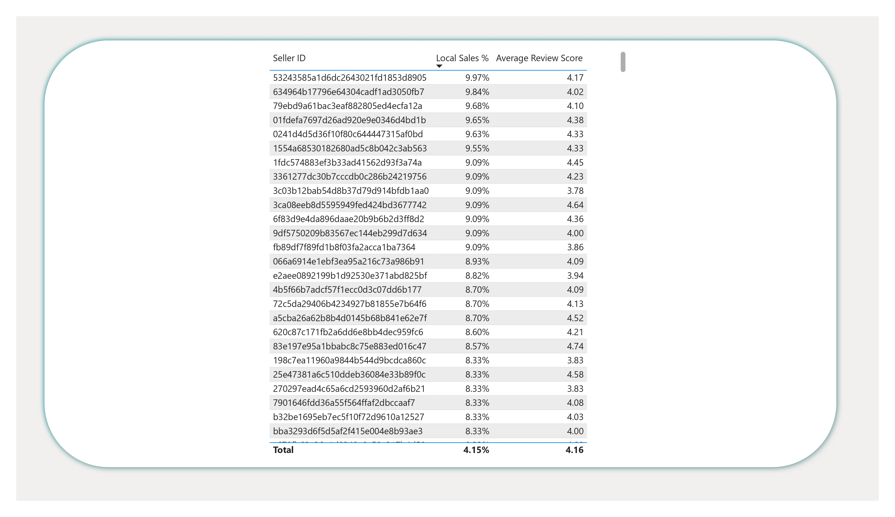

## 4. Analytical Limitations and Recommended Improvements

The following limitations define how the current results should be interpreted and identify the changes needed for more reliable business analysis.

| Area | Limitation | Recommended improvement |
|---|---|---|
| Transaction granularity and KPIs (BR-01, BR-02, BR-04, BR-08, BR-10, BR-13) | Joining order items with aggregated payments can multiply rows within multi-item or multi-payment-method orders, affecting sales, freight, quantities, and payments. | Maintain separate item-level and payment-level facts or use a justified allocation method. Reconcile totals against source records and check category contribution denominators. |
| Customer identity (BR-01, BR-03) | Removing `customer_unique_id` prevents reliable repeat-customer identification. Last observed purchase year does not necessarily satisfy the annual churn definition. | Retain the persistent identifier and compare distinct customers across consecutive years using the required churn definition. |
| Order selection (all transaction-based analyses) | Timestamp filters, inner joins, and shipping deadline conditions restrict coverage and may exclude valid early deliveries. | Reassess eligibility rules and document their impact on retained orders. |
| Geography | City-name normalization does not guarantee a unique location for each postal code prefix. | Standardize postal codes and establish appropriate geographic relationship keys. |
| Product attributes (BR-02, BR-04) | Missing category and photo-count values affect coverage; category mix can influence the photo–quantity comparison. | Report missing-value treatment explicitly and compare photo counts within comparable categories. |
| Market basket analysis (BR-05) | Repeated order-category rows may distort association counts, and the implemented lift expression differs from the standard definition. | Deduplicate order-category combinations, count distinct orders, and calculate lift as confidence divided by consequent support. |
| Time-based comparisons (BR-06, BR-07, BR-13) | Observed purchase dates are not launch dates; incomplete years and overlapping 90-day windows may distort comparisons. | Use comparable periods and disclose partial or overlapping windows. Separate product-level from category-level patterns and use the intended demand measure. |
| Price analysis (BR-08) | Average aggregated transaction price is not average unit price. | Calculate unit price as reconciled total item revenue divided by quantity sold and use consistent comparison periods. |
| Promotion simulation (BR-09) | Actual costs are unavailable, and applying a fixed profit margin to paid revenue omits the cost of free units. | Deduct the cost of all distributed units from paid revenue and apply the required analysis period. Treat results as assumption-based estimates. |
| Reviews and fulfillment (BR-11, BR-12) | Repeated reviews, relationship filter behavior, and transaction-row weighting may affect averages. | Establish the intended review and order grains, check filter propagation, and calculate durations once per order where appropriate. |
| Seller eligibility (BR-14) | The implemented local-sales ratio divides local transaction-row counts by distinct order counts; reviews may also involve orders with multiple sellers. | Define a consistent local revenue or order share, establish review attribution, and apply both eligibility thresholds. |
| Workflow reproducibility | Connection and export settings limit portability. | Externalize environment-specific settings. |

## 5. Conclusion

The project demonstrates data preparation, multi-table integration, exploratory business analysis, DAX measure development, and Power BI reporting across 14 business requirements. The documented preparation results show the changes made to customer, geographic, product, order, payment, and review data.

The dashboard provides an exploratory view of sales performance, customer behavior, product demand, promotional scenarios, payment preferences, fulfillment, and seller performance. The implemented pages demonstrate coverage of the business requirements, but coverage alone does not establish calculation accuracy. Financial, retention, association-rule, and profitability results should be interpreted in light of the limitations above.

The recommended improvements focus on strengthening metric definitions, data granularity, and analytical reliability; they are not claims of realized business impact.
